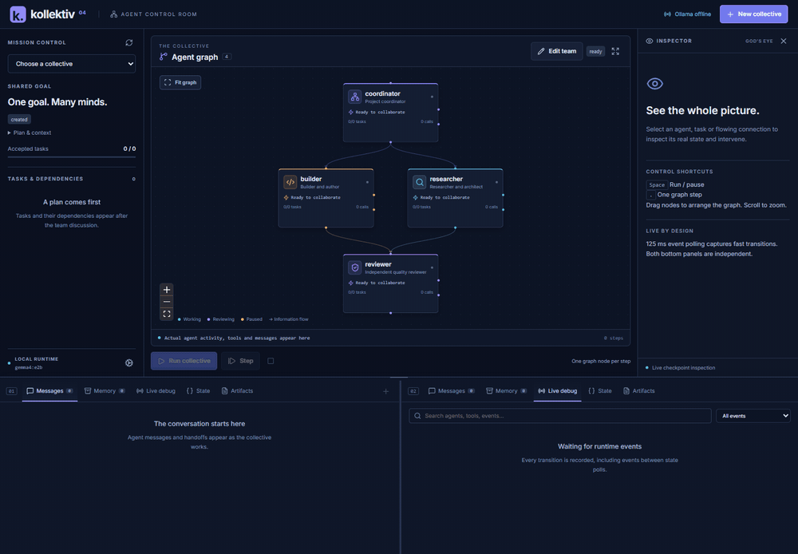

# Kollektiv 4

A local collective of agents that discuss a shared goal, break it into tasks, create files,
review each other's work, and revise the result. Runs use **LangGraph** for orchestration,
**LangChain** for models and tools, and **Ollama** with `gemma4:e2b` by default.

The earlier experiments live in `_archive/v1`, `_archive/v2`, and `_archive/v3`.
The current implementation is in `src/kollektiv`.



This short recording uses scripted model responses with the real graph, tools and checkpoints.

## Start

Requires Python 3.11+ and Ollama with the model installed. From the repository root:

```powershell
ollama pull gemma4:e2b
uv sync
uv run kollektiv doctor --generate
uv run kollektiv serve --open
```

If Ollama is not already running, start `ollama serve` in a separate terminal.
No cloud credentials are required. Open `http://127.0.0.1:8765` for the agent graph control room.
To try a mission, choose **New collective → Mission sample** in the UI. Easy, medium and elaborate
samples load editable goals and matching task budgets. Each tier has two offline examples.
From the terminal, use `uv run kollektiv run "Write a short poem about a robot in poem.md"`.
A mission takes several model calls; progress appears as agents respond. Ollama speed depends
on the machine and the amount of content requested.

With pip instead of uv:

```powershell
py -3.12 -m venv .venv
.\.venv\Scripts\python.exe -m pip install -e .
.\.venv\Scripts\python.exe -m kollektiv doctor --generate
.\.venv\Scripts\python.exe -m kollektiv run "Write a short poem about a robot in poem.md"
```

For a longer goal, put the full requirements in a UTF-8 file:

```powershell
uv run kollektiv run --goal-file mission.txt
uv run kollektiv run "Research ways to structure a multiplayer Pong project and write a sourced plan in plan.md" --web
```

Create `mission.txt` with your own requirements. The UI's mission samples start small; elaborate
missions take longer and may benefit from a larger model or larger context and output budgets.

## How the collective works

The default team has four distinct personas:

| Agent | Responsibilities | Tools |
| --- | --- | --- |
| `coordinator` | Integrate team advice into phases, tasks, dependencies and acceptance criteria | Read files, messages, shared notes |
| `researcher` | Research, architecture, shared conventions and writing | File tools, messages, notes, optional web tools |
| `builder` | Implement and author complete deliverables | File tools, messages, notes |
| `reviewer` | Independently review artifacts and assess the entire goal | Read files, deterministic checks, messages, notes |

1. **Discuss and research.** Every persona contributes recommendations and can send permitted messages.
   A second round lets teammates respond to their inboxes. With `--web`, researchers can search
   and browse before the plan is created.
2. **Plan.** The coordinator produces a validated plan with phases, one file per task, exact
   output paths, suitable owners, acceptance criteria and a dependency DAG.
   Draft/edit steps for the same file are combined while preserving instructions, criteria and
   external dependencies. Cycles and unknown task references fail validation.
3. **Act.** LangGraph's `Send` dispatches ready tasks to worker subgraphs. Workers use native
   LangChain tool calls to read inputs, write their assigned file, send messages and save notes.
   Workers cannot overwrite another task's deliverable.
4. **Review and reflect.** The reviewer reads the actual file and its inputs. Missing, empty,
   or syntactically invalid Python/JSON files fail deterministic checks. Rejected work returns
   to its owner with feedback; accepted work unlocks dependent tasks. Lessons enter shared memory.
5. **Audit the goal.** The reviewer checks all deliverables together against the original goal.
   It can reopen tasks or add missing deliverables. Revising an input also reopens its dependents.
   Only an accepted whole-goal review produces `completed`.

This is a fixed workflow with a dynamic team and task graph; adding a persona or changing the
number of tasks does not require generating graph code. See [workflow.mmd](workflow.mmd), or
run `uv run kollektiv graph` to render the current structure as Mermaid.

Direct messages are addressed to an exact teammate name; `all` broadcasts to the team.
Shared notes, discussion findings, task reflections and review feedback persist in the checkpoint.
Tasks dispatched in the same wave share the wave's starting context. Messages from that wave
become available to subsequent tasks; task dependencies establish ordering when a handoff is needed.

## Agent graph control room

```powershell
uv run kollektiv serve --open
# Or pick another local port:
uv run kollektiv serve --port 8766
```

The browser combines the team and its live activity in a draggable, zoomable agent graph.
Colored person cards show agent state, task progress and recent tools; directed edges animate
actual messages, and tool calls appear as loops around their agent. Select a person, channel,
task, event or artifact to inspect its details on the right.

The left sidebar holds the mission, phases and task states. A full-width bottom dock has two
independent tabbed panes, so messages and live debug can stay visible together. Each pane can
also show memory, state or artifacts. Resize the dock height and pane split with the handles
or their keyboard arrow controls. On narrow screens, the panes stack and the inspector becomes
a dismissible drawer. Animations respect the operating system's reduced-motion preference.

**Edit team** opens a draft configuration. Add or remove agents; select a person to edit its name,
role, instructions, skills, model and tool permissions. Choose the coordinator and reviewer.
Drag from a source handle to another person's target handle to create a directed communication
path. Use a path's remove button to delete it. Node positions are saved too.

Save drafts to the server's configuration library, reload them, or export/import portable JSON.
Presets live in `runs/_configurations/` by default and survive restarts. Creating a collective
from the draft preserves the current run and starts a new run with its own team and layout.
Saved configurations can omit a mission goal; starting a run requires one.

Unrestricted messaging preserves the default team's behavior. With directed paths, discretionary
messages can only reach permitted outgoing neighbors; broadcasts expand to those neighbors.
Removing `send_message` disables those messages as well. Automatic review feedback, task status
and admin instructions still reach their intended recipients; shared memory stays collective.
These paths control communication, while task dependencies control execution order.

The runtime graph preserves dragged positions across reloads and offers **Reset view** to bring
all people into view. Resizing and run changes fit the graph after its nodes are measured;
moving message packets follow the displayed path as nodes are dragged or the camera changes.

Create a goal and configure its model/team, then start it or step through one graph node at a time.
Steps include individual worker model calls, tool executions and reviews. Pause waits for the
current node to finish; stop preserves a checkpoint you can resume. Existing CLI runs appear in
the same run selector.

God's Eye controls let you send an admin message, add shared memory, retry a task, reassign it to
another worker, or edit an artifact. Pause first. Admin edits stop the paused runner, change its
checkpoint, and prepare it for a fresh step or resume, so edits cannot race an executing node.
Artifact changes reopen the affected task and its dependents for review. Goal and team settings
can be edited before the first graph execution; a different goal needs a new run after work starts.

The state inspector includes active worker checkpoints and tool history. The debug feed exposes
model responses, tool calls/results, checksums, reviews, control changes and failures.
While running, the frontend polls the lightweight event feed every 125 ms and refreshes the
full checkpoint approximately every 750 ms. Every event is read from the durable log, including
transitions that finish between polls. Idle and hidden tabs poll less often. Transport latency
appears in the header; model/server health is checked separately.

## Inspect and resume

Each invocation creates a unique `runs/<timestamp>-<id>/` directory containing:

| File | Purpose |
| --- | --- |
| `artifacts/` | Actual deliverables; the only location workers can write |
| `run.json` | Original goal, team, model and settings |
| `checkpoints.sqlite` | Durable graph and worker checkpoints |
| `state.json`, `plan.json` | Inspectable snapshots of task progress and the plan |
| `messages.json`, `memory.json` | Team communication and shared memory |
| `events.jsonl` | Model usage, tool results, artifact checksums, reviews and interruptions |
| `report.md` | Result, deliverable links and review evidence |

```powershell
uv run kollektiv list
uv run kollektiv status runs/<run-id>
uv run kollektiv status runs/<run-id> --json
uv run kollektiv resume runs/<run-id>
```

Ctrl+C or a model/network failure leaves progress checkpointed. Resume uses the saved goal and
configuration and continues unfinished graph nodes, including a worker's tool history.
Previously accepted files are verified by checksum; changed or missing files and their dependent
tasks are rebuilt and reviewed. An OS-held lock prevents two processes from advancing the same run.

Retries and revisions are bounded. Exhausting a budget produces `incomplete`, keeps the work and
feedback, and exits with code 2. A model or configuration error exits with code 1. To deliberately
give an incomplete run another attempt budget:

```powershell
uv run kollektiv resume runs/<run-id> --retry
```

## Configure the team and model

```powershell
uv run kollektiv run --goal-file mission.txt --config team.json
uv run kollektiv run "Your full goal" --model gemma4:e4b --base-url http://localhost:11434
uv run kollektiv resume runs/<run-id> --config overrides.json
```

Configuration is JSON. Omitted settings use defaults; resume configuration overrides only supplied
top-level fields. See [Settings and Agent](src/kollektiv/config.py) for the full validated schema.
`--config` also accepts a team configuration exported from the editor. Its settings are applied;
the CLI goal argument or goal file supplies the mission.

| Setting | Default | Effect |
| --- | --- | --- |
| `model`, `base_url` | `gemma4:e2b`, `http://localhost:11434` | Ollama model and server |
| `reasoning` | `false` | Enable Ollama thinking for models supporting it |
| `num_ctx`, `num_predict` | `32768`, `8192` | Model context and maximum output tokens per call |
| `context_chars` | `60000` | Maximum artifact text supplied for a review |
| `request_timeout` | `180` | Seconds allowed per model request |
| `max_concurrency` | `1` | Graph task concurrency; default suits a single local model |
| `discussion_rounds` | `2` | Team discussion rounds before planning |
| `max_tasks` | `24` | Maximum total tasks, including goal-review additions |
| `max_steps` | `12` | Model/tool steps per task attempt |
| `max_task_attempts` | `3` | Attempts per task per goal revision |
| `max_goal_revisions` | `2` | Whole-goal correction rounds |
| `structured_retries` | `2` | Schema repair retries using validation feedback |
| `web_enabled` | `false` | Permit web tools for personas configured with them |
| `communication_links` | `null` | Unrestricted optional messaging; a list of `{source, target}` paths restricts it, and `[]` disables it |

A custom `team` replaces the whole roster. Each agent has `name`, `role`, `persona`, `skills`,
`tools`, and an optional `model`. The `coordinator` and `reviewer` settings name two different team
members; at least one other member must have `write_file`. For example, copy the roster from
`run.json`, change the personas or per-agent models, and provide it in your config.

Artifacts are text files of any extension, with a configurable size limit. Generated programs
are checked for Python/JSON syntax where applicable and reviewed by the model. They are not
executed by this application, so test generated software before relying on it. Completion is the
collective's evidence-based assessment, and its quality still depends on the model. A small local
model may need more attempts or a more explicit goal for large or complex projects.

If a review would exceed `context_chars`, the run stops with a resumable error instead of
approving partially visible files. Increase both `context_chars` and `num_ctx` when resuming.
If generation reaches `num_predict`, increase that budget. Web lookup failures are reported as
tool results and do not supply invented sources.

## Python API

```python
from kollektiv import Collective, Settings

run = Collective.create(
    "Create design.md and a consistent short story in story.md.",
    runs_dir="runs",
    settings=Settings(model="gemma4:e2b"),
)
result = run.run()
print(result["status"], run.workspace.root)

# Later, including from another process:
result = Collective.open(run.directory).run()
```

## Development and validation

The frontend source is in `frontend/`, built with React, TypeScript and Vite. It uses
[React Flow](https://reactflow.dev/) for graph interaction, Dagre for initial layout,
Zustand for runtime state, and Lucide for icons. Modules separate the transport/store,
graph, mission overview, inspector, dock and intervention forms. Components consume typed
snapshots and events through `api.ts`; `useRuntime.ts` owns polling and reconnection.

The compiled frontend is checked into `src/kollektiv/web/` and included in the Python package.
It ships one JavaScript bundle for compatibility with existing control-room processes.
Running the control room needs no Node installation. To change its source, install Node 20.19+
or 22.12+ and run:

```powershell
cd frontend
npm ci
npm run dev
```

Start `uv run kollektiv serve` from the repository root in another terminal. Vite's development
server proxies `/api` to `127.0.0.1:8765`. After editing, regenerate the packaged assets and check
the frontend:

```powershell
cd frontend
npm run build
npm test
npm run test:e2e
npm run format:check
```

The browser test starts an isolated server with scripted models, real tools and checkpoints;
it does not require Ollama or touch normal runs. It uses installed Microsoft Edge on Windows;
elsewhere, install Playwright Chromium with `npx playwright install chromium`, or set
`BROWSER_PATH` to a browser executable. Port 8767 must be free so the test can create its own
temporary workspace.

To regenerate the README recording with Playwright and FFmpeg, start a separate scripted demo
server from the repository root, then record from `frontend/` in another terminal:

```powershell
uv run python tests/ui_server.py --port 8768 --delay 0.12
# In the second terminal:
cd frontend
npm run demo:record
```

The recorder uses only this temporary server; it never modifies normal runs.

Run the Python checks from the repository root:

```powershell
uv sync --extra dev
uv run pytest -q
uv run ruff check src tests
uv run ruff format --check src tests
```

The automated tests exercise the real graph, tool execution and SQLite persistence with scripted
model responses: dependencies, direct-message delivery, rejection and correction, goal revisions,
missing deliverables, crash recovery after a file write, artifact changes, isolated runs and write
confinement. `doctor --generate` and the smoke goal exercise the installed Ollama model.

The implementation follows the official
[LangGraph orchestrator/worker and evaluator/optimizer patterns](https://docs.langchain.com/oss/python/langgraph/workflows-agents)
and [ChatOllama integration](https://docs.langchain.com/oss/python/integrations/chat/ollama).

See [mcp_research.md](mcp_research.md) for researched local MCP hosting options, compatibility
constraints and a staged integration proposal. MCP integration is a future option.
