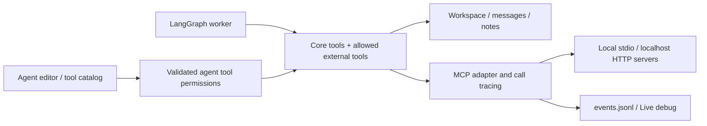

# Locally hosted MCP servers for Kollektiv

Researched **12 October 2026** using protocol specifications, published package metadata, release tags, and maintainers' documentation. This is a proposal; MCP integration has not been installed or implemented in this change.

## Recommendation for this project

Add MCP as an optional **external-tool adapter**. Keep LangGraph's discussion, planning, review, SQLite checkpoints, and run controls. Keep the built-in `send_message`, `share_note`, and artifact tools: they update collective state and enforce task ownership. Start with a local web-fetch server, then add browser or repository tools when a mission needs them. MCP standardizes tool access; it does not replace Kollektiv's scheduler, memory, or acceptance checks. This recommendation follows the current boundaries in [`Toolkit`](src/kollektiv/tools.py), [`Workflow`](src/kollektiv/workflow.py), [`Workspace`](src/kollektiv/workspace.py), and [`Collective`](src/kollektiv/runtime.py).

The main benefit is exchanging custom integrations for maintained clients, schemas, transports, and servers. The cost is subprocess/service management and another failure boundary. A small optional adapter isolates that cost and lets ordinary offline missions continue without MCP.

## Current compatibility: older tutorials need care

| Component | Verified status | Consequence |
| --- | --- | --- |
| MCP protocol | Published revision **2026-07-28** replaces connection-level initialization and sessions with request metadata and discovery. Earlier revisions remain relevant for compatibility. [Dated specification](https://modelcontextprotocol.io/specification/2026-07-28/basic/transports), [changelog](https://modelcontextprotocol.io/specification/2026-07-28/changelog) | Persist mission/browser/application state explicitly; a protocol session is not a durable run. |
| Official Python SDK, package `mcp` | **2.0.0** was explicitly released as stable on 28 July; **2.3.0** was published on 2 October. The former SDK `FastMCP` class is now `MCPServer`; v1 is maintained for critical/security fixes. [Stable release](https://github.com/modelcontextprotocol/python-sdk/releases/tag/v2.0.0), [2.3.0 release](https://github.com/modelcontextprotocol/python-sdk/releases/tag/v2.3.0), [published package](https://pypi.org/project/mcp/2.3.0/) | Use current SDK imports for new custom servers. Pin versions and test legacy servers. |
| Standalone FastMCP, package `fastmcp` | Separate framework, retaining `from fastmcp import FastMCP`; **4.1.0** published on 8 October. Its documentation explicitly tracks `main`, which can contain unreleased features. [Tagged release](https://github.com/PrefectHQ/fastmcp/releases/tag/v4.1.0), [documentation caveat](https://gofastmcp.com/getting-started/welcome) | Prefer released features verified against a pinned package. Do not confuse this with SDK v1's similarly named class. |
| LangChain integration | Current `langchain.mcp.MCPAdapter` requires `langchain[mcp]>=1.4.0` and is **beta**. The standalone `langchain-mcp-adapters` repository was archived on 17 September. [Current guide](https://docs.langchain.com/oss/python/langchain/mcp), [archive notice](https://github.com/langchain-ai/langchain-mcp-adapters) | Use the current optional extra behind a narrow boundary for new work, accepting a beta API. |
| Existing environment | Locally verified: LangChain **1.4.4**, LangGraph **1.2.14**, LangChain Ollama **1.1.0**; neither `mcp` nor `fastmcp` is installed. LangChain 1.4.4's MCP extra requires `fastmcp>=4.0.11,<5`; FastMCP's client/server extras require SDK **2.x**. [LangChain package metadata](https://pypi.org/pypi/langchain/1.4.4/json), [FastMCP dependency metadata](https://pypi.org/pypi/fastmcp-slim/4.1.0/json) | Version constraints align with the existing LangChain line, but no runtime compatibility claim is made until integration tests pass. |

## Hosting choices

| Option | What it provides | Suggested use |
| --- | --- | --- |
| **stdio subprocess** | The client launches the server; JSON-RPC uses stdin/stdout, with logs on stderr. Shutdown closes input, waits, then terminates an unresponsive process. [stdio specification](https://modelcontextprotocol.io/specification/2026-07-28/basic/transports/stdio) | First choice for this local Windows app: no listening port; own the process for the run or application lifetime. |
| **Streamable HTTP on localhost** | An independently running server accepts POST requests at one MCP endpoint, returning JSON or request-scoped SSE. The current revision removes protocol sessions and the old GET stream. [HTTP specification](https://modelcontextprotocol.io/specification/2026-07-28/basic/transports/streamable-http) | Share expensive browser/database services across runs. Use separate application identities/state and a clear service lifecycle. |
| **In-process server** | The current LangChain adapter supports an in-memory FastMCP target without a socket or subprocess. [Adapter targets](https://docs.langchain.com/oss/python/langchain/mcp) | Deterministic contract tests and a possible future wrapper exposing Kollektiv's own guarded tools. |
| **Container/gateway** | Docker's gateway routes tools and manages container lifecycle, credentials, restrictions, and tracing. Current docs distinguish the open-source gateway from an invite-only AI Governance offering. [Docker gateway](https://docs.docker.com/ai/mcp-catalog-and-toolkit/mcp-gateway/) | Later option if several servers need consistent isolation. It adds an installation dependency and should remain optional. |

For Python servers, pinned `uvx --from package==version command` runs in an environment isolated from this project. That matters today: the published Fetch and Git servers require **`mcp>=1.29,<2`**, while the current LangChain client stack requires **2.x**. Separate processes avoid that dependency conflict. [uv tools](https://docs.astral.sh/uv/guides/tools/), [Fetch metadata](https://pypi.org/pypi/mcp-server-fetch/2026.10.10/json), [Git dependencies](https://github.com/modelcontextprotocol/servers/blob/main/src/git/pyproject.toml)

For Node servers, install a reviewed version in a dedicated directory with a lockfile and launch its executable with an explicit Node path; use pinned containers if isolation is needed. Resolve Windows executable paths during setup instead of depending on whichever `npx` happens to be on PATH. Pinning the top-level package alone does not freeze its transitive dependencies; a dedicated locked environment/image is preferable for repeatable production use.

## Useful local servers

The MCP steering group's server repository labels its servers **reference implementations**, not production-ready solutions. Evaluate the actual implementation and a published version rather than treating inclusion as a security guarantee. [Repository scope](https://github.com/modelcontextprotocol/servers)

| Server | Fit and limits for Kollektiv |
| --- | --- |
| **Fetch** | Best initial experiment replacing `web_browse`: HTML-to-Markdown with bounded, pageable extraction. Current documentation describes private-address and redirect checks, with limitations around DNS rebinding/proxies; retain those defaults and test the pinned release. It fetches known URLs, so it does not replace search. [Fetch documentation](https://github.com/modelcontextprotocol/servers/blob/main/src/fetch/README.md) |
| **Filesystem** | Node reference server provides broad reads/writes/moves/search and allowed directories; client roots can replace configured directories. Those directory permissions are broader than Kollektiv's assigned-output-only `write_file`. Keep core writes, optionally expose read-only reference folders, and enforce permissions again at invocation. [Filesystem documentation](https://github.com/modelcontextprotocol/servers/blob/main/src/filesystem/README.md) |
| **Git** | Useful status/diff/log/show tools for coding missions; also exposes mutations. `--repository` resolves to the repository root, even when given a subdirectory. Start with a read-only tool allowlist and a separate working copy. [Git documentation](https://github.com/modelcontextprotocol/servers/blob/main/src/git/README.md) |
| **Microsoft Playwright MCP** | Browser automation via accessibility snapshots; supports isolated profiles and local HTTP hosting. Persistent profiles conflict when concurrent clients share one profile. Use isolated contexts or separate profiles per run, disable unnecessary capabilities, and isolate the process: its own documentation says it is not a security boundary. [Playwright MCP](https://github.com/microsoft/playwright-mcp) |
| **Brave Search MCP** | Vendor-maintained search option; its server can run locally over stdio/HTTP, but requires a Brave API key and external service access. Keep DDGS as an optional existing provider if credential-free search matters. [Brave server](https://github.com/brave/brave-search-mcp-server) |

## Integration shape and configuration



Proposed adapter input, **not yet an accepted Kollektiv settings file**:

```json
{
  "mcpServers": {
    "web": {
      "command": "uvx",
      "args": ["--from", "mcp-server-fetch==2026.10.10", "mcp-server-fetch"],
      "env": { "PYTHONIOENCODING": "utf-8" }
    }
  }
}
```

LangChain discovers tools through `await adapter.list_tools()`. Multi-server configurations prefix names as `{server}_{tool}`, making this example's tool `web_fetch`. Tools retain their client after discovery; holding the adapter open can reuse a connection across calls. Older `MultiServerMCPClient.session(...)` examples describe the archived adapter and legacy lifecycle. For mixed protocol eras, separate adapters/`ClientGroup` preserve independent negotiations; one aggregate configuration can negotiate the oldest shared era. [Connection guide](https://docs.langchain.com/oss/python/langchain/mcp/connections), [migration guide](https://docs.langchain.com/oss/python/migrate/langchain-mcp-adapters)

Project-specific implementation suggestions:

1. **Add an optional provider boundary.** Keep built-in tool names stable; add explicit namespaced external references rather than replacing the current `ToolName` validation with unrestricted strings. Discover a server catalog once per run, record its version and schema hashes, and validate each agent's allowlist both before model binding and when executing. Never derive launch commands, environment, or allowed roots from model output.
2. **Handle async deliberately.** The installed adapter implementation returns coroutine-only `StructuredTool`s; this project's worker currently uses synchronous `ToolNode.invoke` and `graph.stream`. Introduce async tool execution/run lifecycle or one managed event-loop bridge with explicit shutdown. Do not scatter `asyncio.run()` across worker threads. Preserve existing pause/step semantics at node boundaries.
3. **Preserve state and observability.** Emit server/tool/agent/task/call IDs, duration, bounded arguments/results, and errors through the existing event stream. Avoid logging credentials or huge binary results. MCP `isError` becomes a tool error message; transport failures raise separately, and structured output lives in a tool artifact. Preserve that distinction instead of flattening every result to text. [Tool conversion](https://docs.langchain.com/oss/python/langchain/mcp/tools)
4. **Bound failures.** Set connect/discovery/tool deadlines, server-specific concurrency limits, and bounded reconnect backoff. Retry safe reads only; a timed-out write may already have happened. Respect stop through the client cancellation mechanism, and record uncertain outcomes. Current stdio cancellation uses a notification; HTTP cancellation closes the response stream. Cancellation does not guarantee rollback. [Transport cancellation](https://modelcontextprotocol.io/specification/2026-07-28/basic/transports)
5. **Keep authority explicit.** Bind HTTP to loopback, validate Origin/Host, and authenticate sensitive services. The specification requires Origin checks and recommends localhost binding/authentication. Maintain a server allowlist and per-call permissions; tool annotations are hints, not trusted authorization. Retain artifact confinement, byte limits, atomic writes, and independent review. Treat fetched pages/tool descriptions as untrusted data. [HTTP security requirements](https://modelcontextprotocol.io/specification/2026-07-28/basic/transports/streamable-http), [tool annotation requirements](https://modelcontextprotocol.io/specification/2026-07-28/server/tools)

## Suggested rollout and validation

**Stage 1:** Optional pinned client extra, one isolated Fetch server, researcher-only `web_fetch`, existing tools unchanged. Compare extracted pages with current browsing, tool-call reliability with Gemma, latency, and context usage. A local tool server can still contact the internet; distinguish hosting location from network behavior.

**Stage 2:** Persist approved server identities and tool selections alongside mission configurations; show availability, schemas, and startup errors in the editor/debug dock. Add Playwright or read-only Git per mission. Browser session state must be restored separately from LangGraph checkpoints. Adapter elicitation can produce LangGraph interrupts; enable it only after the UI/run API supports answering and resuming those interrupts. [Elicitation integration](https://docs.langchain.com/oss/python/langchain/mcp/tools)

**Stage 3:** Consider a thin `MCPServer`/FastMCP wrapper around Kollektiv's guarded artifact API if other applications need it; avoid duplicating workspace policy. Consider a container gateway when operational complexity justifies it.

Before enabling external tools by default, test malformed schemas, missing executables, subprocess crashes, timeout/stop, overlapping workers, denied tools/paths, legacy protocol compatibility, schema changes on resume, and uncertain write outcomes. Use the official MCP Inspector for discovery/call diagnostics and deterministic fake servers for automated tests. [MCP Inspector](https://modelcontextprotocol.io/docs/2026-07-28/tools/inspector)
